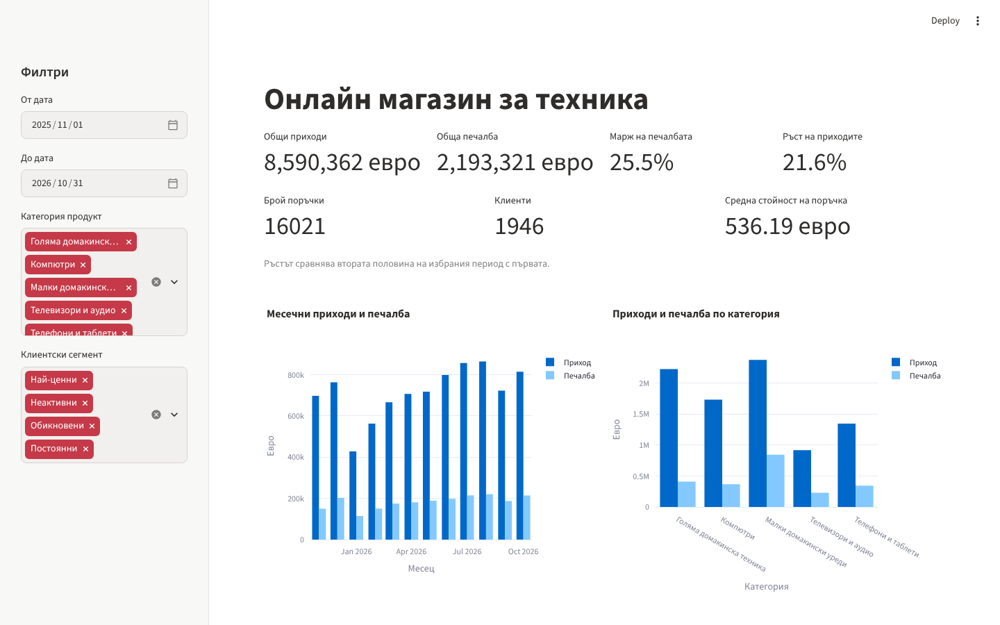
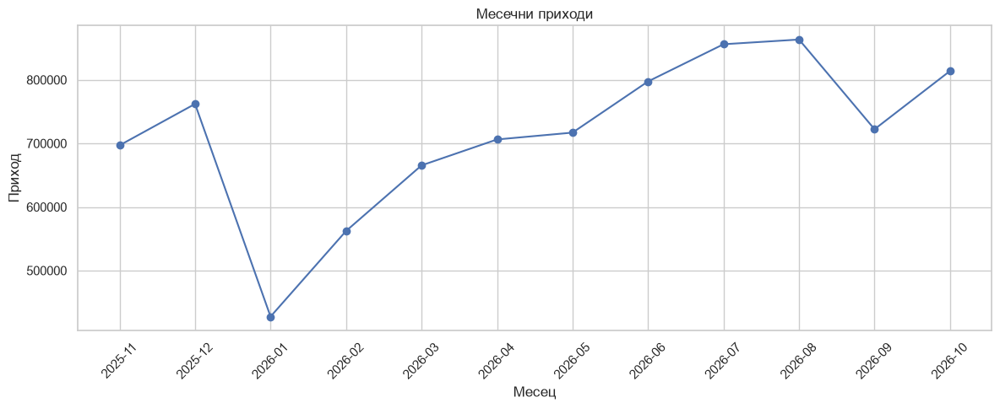
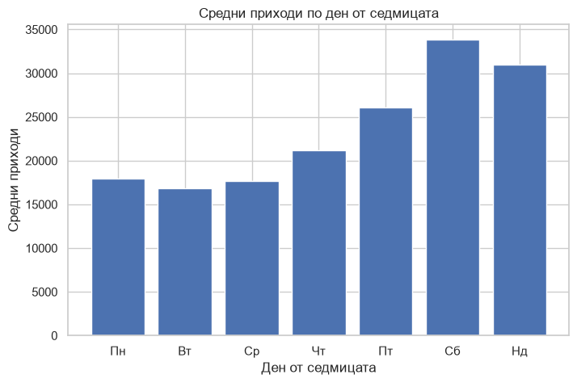
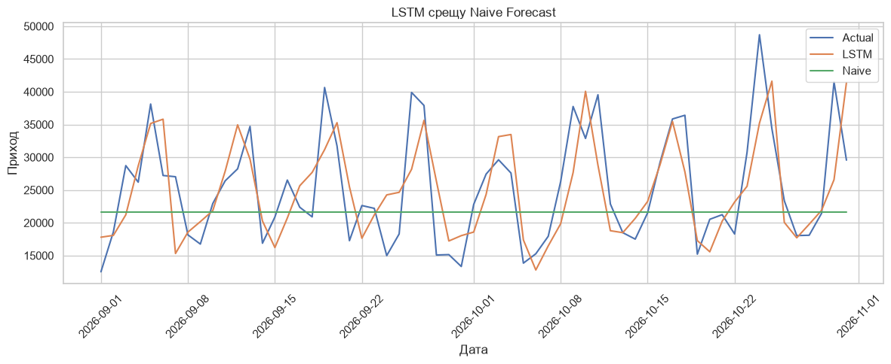
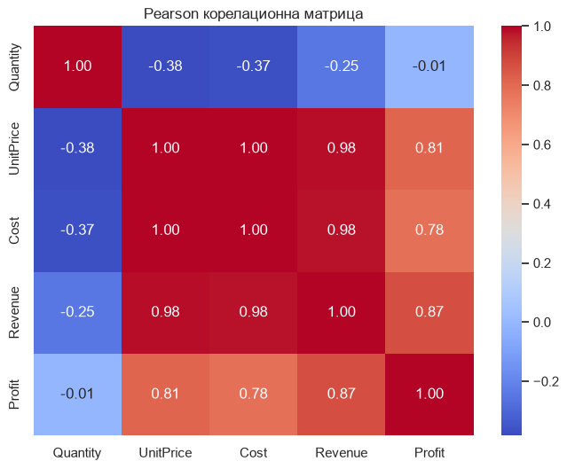
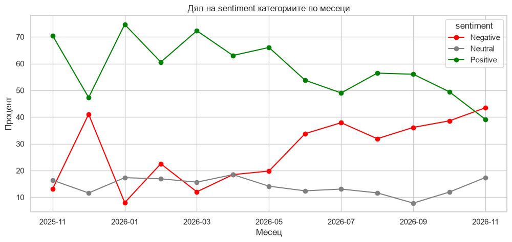
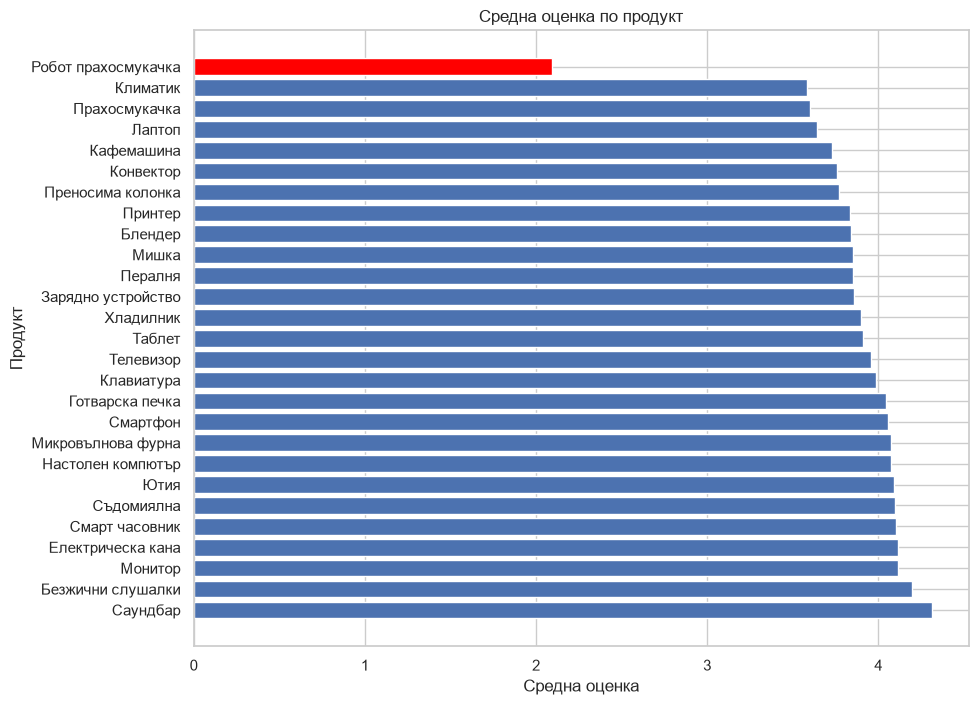
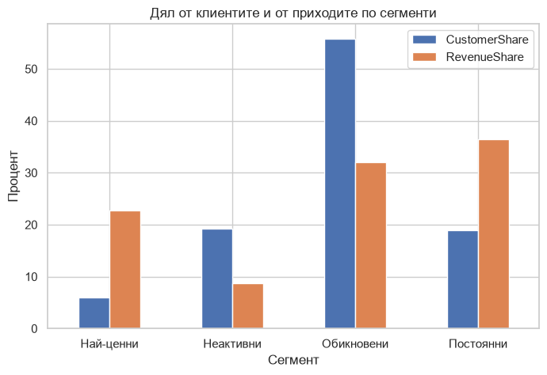
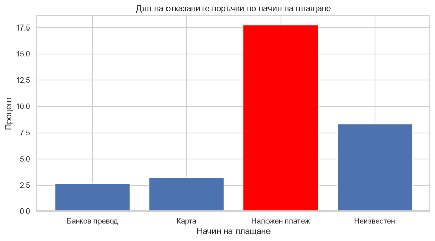

# Онлайн магазин за техника: анализ на продажби, клиенти и мнения


Курсов проект по **„Големи данни с Python“**.

Проектът проследява целия път на данните в един онлайн магазин за техника: от генерирането и почистването им, през статистика, прогнозиране на продажбите и анализ на клиентските мнения, до сегментиране на клиентите, интерактивно табло и бизнес препоръки.



## Данните

Данните са генерирани с **Faker** и **NumPy** за периода **1 ноември 2025 – 31 октомври 2026**. Те следват реалистични правила: сезонност, седмичен ритъм, по-скъпите продукти се купуват по-рядко, а VIP клиентите поръчват по-често. В тях умишлено са заложени „скрити истории“ (дефектна партида, закъснели доставки, повече откази при наложен платеж), които анализът трябва да открие сам. Заложени са и проблеми в данните: липсващи стойности, дубликати, различно изписани градове и грешни количества.

| Таблица | Редове |
|---|---|
| Клиенти | 2 000 |
| Продукти | 27 |
| Поръчки | 17 984 |
| Редове на поръчките | 26 958 |
| Клиентски мнения | 1 434 |

## Етапи

1. **Подготовка и зареждане на данните**: генериране, записване в CSV и първи преглед.
2. **Предварителна обработка**: дубликати, липсващи стойности, уеднаквяване на текст, коригиране на типовете, outliers (box plot, IQR, Z-score), Label и One-Hot Encoding, Min-Max нормализация и стандартизация.
3. **Статистически анализ**: описателна статистика, разпределения (нормално, равномерно, биномиално), корелации на Pearson и Spearman.
4. **Времеви серии и прогнозиране**: ресемплиране, сезонност, хронологично Train/Test разделяне, Naive Forecast, Moving Average, Linear Regression и LSTM, оценени с MAE, MSE и RMSE.
5. **Анализ на клиентските мнения**: почистване на текста, токенизация, stop words, CountVectorizer, биграми, TF-IDF, sentiment analysis с VADER.
6. **Сегментиране на клиентите и бизнес анализ**: RFM, K-means с Elbow метод, KPI, марж по категории, сезонни продукти, клиентско поведение.
7. **Интерактивно табло**: Streamlit и Plotly, с филтри по период, категория и клиентски сегмент.
8. **Изводи и бизнес препоръки**: анализ с езиков модел (Claude API), проверен срещу изчислените показатели, и собствени изводи.

## Основни резултати

- **Приходи 8.59 млн. евро**, печалба 2.19 млн. евро, марж **25.5%**, средна стойност на поръчка **536 евро**.
- Най-силни са **петък, събота и неделя**, а януари е най-слабият месец след празниците.
- **LSTM** прогнозира дневния приход със средна грешка около **4 990 евро**, срещу около 7 040 евро при наивната прогноза.
- Средната оценка на **робота прахосмукачка** пада от 3.97 на 1.84 след юни. Върнатите поръчки за него растат от 1.6% на 34%, което сочи дефектна партида.
- През **декември** 41% от мненията са отрицателни, най-вече заради закъснели доставки.
- При **наложен платеж** около 18% от поръчките са отказани, много повече отколкото при другите начини на плащане.
- **25% от клиентите носят 59% от приходите.**

## Графики

| | |
|---|---|
|  |  |
|  |  |
|  |  |
|  |  |

## Структура

```
BigDataProject/
├── main.ipynb            # целият анализ, етапи 1–8
├── dashboard.py          # интерактивното табло
├── requirements.txt      # нужните библиотеки
├── .streamlit/config.toml
├── data/                 # генерираните и подготвените данни (CSV)
└── images/               # графики за README
```

## Стартиране

```bash
git clone https://github.com/AtanasG6/BigDataProject.git
cd BigDataProject
python -m venv .venv
.venv\Scripts\activate        # Windows; на Linux/macOS: source .venv/bin/activate
pip install -r requirements.txt

jupyter notebook main.ipynb   # анализът
streamlit run dashboard.py    # таблото, на http://localhost:8501
```

Таблото чете готовите файлове в `data/`, затова може да се пусне и без тетрадката.

За етап 8 е нужен ключ за Claude API във файл `claude_key.txt` в папката на проекта. Файлът не е част от хранилището. Без ключ тетрадката продължава да работи и показва съобщение вместо анализа.

## Автор

Атанас Гюлчев
